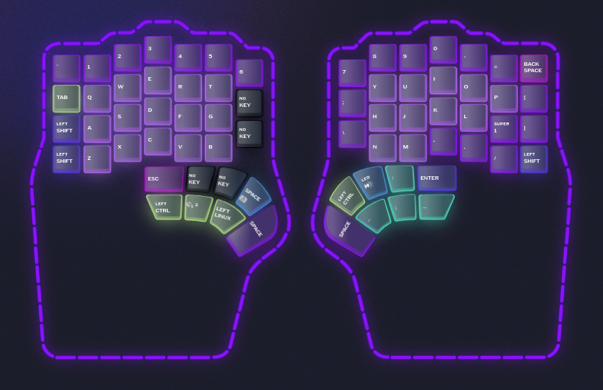
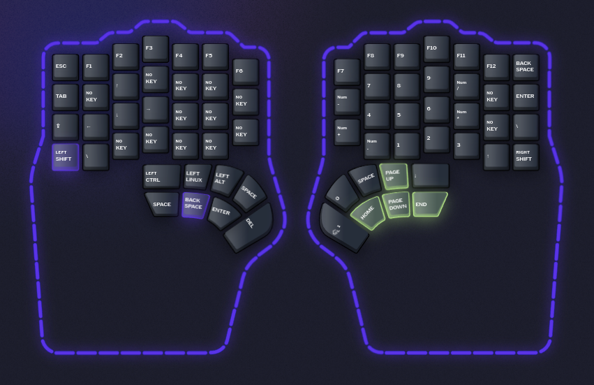

# Dygma Defy Layout

My key mappings for the [Dygma Defy](https://dygma.com/) split keyboard, configured with [Bazecor](https://github.com/Dygmalab/Bazecor) on Fedora Linux.

## Layers

| Layer | Purpose |
|-------|---------|
| 1 | Base typing layer |
| 2 | Navigation and text selection |

### Layer 1

### Layer 2

